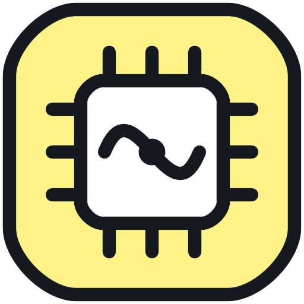

<div align="center">



# ECE MAKAUT Short Notes

### Complete Exam-Ready Academic Notes & Combined Archives for MAKAUT B.Tech ECE (2023–27)

[](https://github.com/Biraj2004/ECE_MAKAUT_Short-Notes)
[](#status)
[](#status)
[](#status)
[](#status)
[](LICENSE)

[](https://biraj2004.github.io/ECE_MAKAUT_Short-Notes/)
[](Notes_Build_Guide.md)
[](pdf_secure.py)

<br/>

**Curated, structured & compiled in XeLaTeX by [Biraj Sarkar](https://iambiraj.vercel.app)**  
*Department of Electronics & Communication Engineering, Cooch Behar Government Engineering College (CGEC)*

[Web Showcase Portal](https://biraj2004.github.io/ECE_MAKAUT_Short-Notes/) • [Developer Portfolio](https://iambiraj.vercel.app) • [MAKAUT PYQ Papers](https://docs.google.com/document/d/1NLcByiSlAugGMJxNbXkBvEaA9jEwVhUt-21GkwoT_ZE/edit?tab=t.0#heading=h.vpuhncm2s6km) • [Style Guide](Notes_Build_Guide.md)

</div>

---

Every topic follows: **Definition → Concept → Working → Formula → Diagram → Advantages/Disadvantages → Applications → Exam Points**

---

## Status

| Semester | Status | Subjects | Official Syllabus |
|---|---|---|---|
| [1st SEM](#1st-semester) | Notes available | 3 subjects (18 modules) | [2026–27 curriculum](1st%20SEM/New%20Syllabus%20Subjects/SEM-1%20NEW_ECE_MAKAUT_SYLLABUS_2026-27.pdf) · [Previous curriculum](1st%20SEM/SEM-1%20OLD_ECE_MAKAUT_SYLLABUS.pdf) |
| [2nd SEM](#2nd-semester) | Previous-curriculum notes available | 2 subjects (12 modules) | [2026–27 curriculum](2nd%20SEM/New%20Syllabus%20Subjects/SEM-2%20NEW_ECE_MAKAUT_SYLLABUS_2026-27.pdf) · [Previous curriculum](2nd%20SEM/SEM-2%20OLD_ECE_MAKAUT_SYLLABUS.pdf) |
| [3rd SEM](#3rd-semester) | ✅ Complete | 6 subjects (27 modules) | [`SEM-3 ECE_MAKAUT_SYLLABUS.pdf`](3rd%20SEM/SEM-3%20ECE_MAKAUT_SYLLABUS.pdf) |
| [4th SEM](#4th-semester) | ✅ Complete | 6 subjects (29 modules) | [`SEM-4 ECE_MAKAUT_SYLLABUS.pdf`](4th%20SEM/SEM-4%20ECE_MAKAUT_SYLLABUS.pdf) |
| [5th SEM](#5th-semester) | 🟡 In Progress | 2 subjects (12 modules) | [`SEM-5 ECE_MAKAUT_SYLLABUS.pdf`](5th%20SEM/SEM-5%20ECE_MAKAUT_SYLLABUS.pdf) |
| [6th SEM](#6th-semester) | ✅ Complete | 10 subjects (55 modules) | [`SEM-6 ECE_MAKAUT_SYLLABUS.pdf`](6th%20SEM/SEM-6%20ECE_MAKAUT_SYLLABUS.pdf) |
| [7th SEM](#7th-semester) | ✅ Complete | 13 subjects (80 modules) | [`SEM-7 ECE_MAKAUT_SYLLABUS.pdf`](7th%20SEM/SEM-7%20ECE_MAKAUT_SYLLABUS.pdf) |
| [8th SEM](#8th-semester) | ✅ Complete | 12 subjects (63 modules) | [`SEM-8 ECE_MAKAUT_SYLLABUS.pdf`](8th%20SEM/SEM-8%20ECE_MAKAUT_SYLLABUS.pdf) |

> Every semester folder also includes a dedicated `New Syllabus Subjects/` subfolder reserved for new curriculum (NEP 2020) syllabus modules.

---

## 1st Semester

| Code | Subject | Curriculum | Modules |
|---|---|---|---|
| 26-ES-EE101 | [Basic Electrical and Electronics Engineering](1st%20SEM/New%20Syllabus%20Subjects/01.%20Basic%20Electrical%20and%20Electronics%20Engineering/26-ES-EE101_Basic_Electrical_and_Electronics_Engineering.pdf) | 2026–27 | 6 |
| BS-CH101 | [Chemistry-I](1st%20SEM/01.%20Chemistry-I/BS-CH101_ChemistryI.pdf) | Previous | 7 |
| BS-PH101 | [Physics-I](1st%20SEM/02.%20Physics-I/BS-PH101_PhysicsI.pdf) | Previous | 5 |

---

## 2nd Semester

The table lists previous-curriculum notes. The 2026–27 syllabus is available above, and notes for it are pending.

| Code | Subject | Modules |
|---|---|---|
| BS-CH101 | [Chemistry-I](2nd%20SEM/01.%20Chemistry-I/BS-CH101_ChemistryI.pdf) | 7 |
| BS-PH101 | [Physics-I](2nd%20SEM/02.%20Physics-I/BS-PH101_PhysicsI.pdf) | 5 |

---

## 3rd Semester

| Code | Subject | Modules |
|---|---|---|
| EC301 | [Electronic Devices](3rd%20SEM/01.%20Electronic%20Devices/EC301_Electronic_Devices.pdf) | 4 |
| EC302 | [Digital System Design](3rd%20SEM/02.%20Digital%20System%20Design/EC302_Digital_System_Design.pdf) | 4 |
| EC303 | [Signals and System](3rd%20SEM/03.%20Signals%20and%20System/EC303_Signals_and_System.pdf) | 5 |
| EC304 | [Network Theory](3rd%20SEM/04.%20Network%20Theory/EC304_Network_Theory.pdf) | 4 |
| ES-CS301 | [Data Structure & Algorithms](3rd%20SEM/05.%20Data%20Structure%20and%20Algorithms/ES-CS301_Data_Structure_and_Algorithms.pdf) | 4 |
| BS-M301 | [Probability and Statistics](3rd%20SEM/06.%20Probability%20and%20Statistics/BS-M301_Probability_and_Statistics.pdf) | 6 |

---

## 4th Semester

| Code | Subject | Modules |
|---|---|---|
| EC401 | [Analog Communication](4th%20SEM/01.%20Analog%20Communication/EC401_Analog_Communication.pdf) | 4 |
| EC402 | [Analog Circuits](4th%20SEM/02.%20Analog%20Circuits/EC402_Analog_Circuits.pdf) | 4 |
| EC403 | [Microprocessor and Microcontroller](4th%20SEM/03.%20Microprocessor%20and%20Microcontroller/EC403_Microprocessor_and_Microcontroller.pdf) | 4 |
| ES-CS401 | [Design and Analysis of Algorithms](4th%20SEM/04.%20Design%20and%20Analysis%20of%20Algorithms/ES-CS401_Design_and_Analysis_of_Algorithms.pdf) | 5 |
| BS-M401 | [Numerical Methods](4th%20SEM/05.%20Numerical%20Methods/BS-M401_Numerical_Methods.pdf) | 3 |
| BS-B401 | [Biology for Engineers](4th%20SEM/06.%20Biology%20for%20Engineers/BS-B401_Biology_for_Engineers.pdf) | 9 |

---

## 5th Semester

| Code | Subject | Modules |
|---|---|---|
| EC501 | [Electromagnetic Waves](5th%20SEM/01.%20Electromagnetic%20Waves/EC501_Electromagnetic_Waves.pdf) | 5 |
| EC502 | [Computer Architecture](5th%20SEM/02.%20Computer%20Architecture/EC502_Computer_Architecture.pdf) | 7 |

---

## 6th Semester

| Code | Subject | Modules |
|---|---|---|
| EC601 | [Control System](6th%20SEM/01.%20Control%20System/EC601_Control_System.pdf) | 7 |
| EC602 | [Computer Network](6th%20SEM/02.%20Computer%20Network/EC602_Computer_Network.pdf) | 4 |
| HS-HU601 | [Economics for Engineers](6th%20SEM/03.%20Economics%20For%20Engineers/HS-HU601_Economics_for_Engineers.pdf) | 4 |
| PE-EC603A | [Introduction to MEMS](6th%20SEM/06.%20Introduction%20to%20MEMS/PE-EC603A_Introduction_to_MEMS.pdf) | 4 |
| PE-EC603B | [Bio-Medical Electronics](6th%20SEM/07.%20Bio-Medical%20Electronics/PE-EC603B_BioMedical_Electronics.pdf) | 4 |
| PE-EC603C | [CMOS VLSI Design](6th%20SEM/10.%20CMOS%20VLSI%20Design/PE-EC603C_CMOS_VLSI_Design.pdf) | 6 |
| PE-EC603D | [Information Theory and Coding](6th%20SEM/04.%20Information%20Theory%20and%20Coding/PE-EC603D_Information_Theory_and_Coding.pdf) | 3 |
| OE-EC604A | [Electronic Measurement and Measuring Instruments](6th%20SEM/09.%20Electronic%20Measurement%20and%20Measuring%20Instruments/OE-EC604A_Electronic_Measurement_and_Measuring_Instruments.pdf) | 5 |
| OE-EC604B | [Operating System](6th%20SEM/08.%20Operating%20System/OE-EC604B_Operating_System.pdf) | 9 |
| OE-EC604C | [Object Oriented Programming](6th%20SEM/05.%20Object%20Oriented%20Programming/OE-EC604C_Object_Oriented_Programming.pdf) | 9 |

---

## 7th Semester

| Code | Subject | Modules |
|---|---|---|
| HS-HU701 | [Principles of Management](7th%20SEM/01.%20Principles%20of%20Management/HS-HU701_Principles_of_Management.pdf) | 4 |
| PE-EC701A | [Microwave Theory and Technique](7th%20SEM/02.%20Microwave%20Theory%20and%20Technique/PE-EC701A_Microwave_Theory_and_Technique.pdf) | 9 |
| PE-EC701B | [Satellite Communication](7th%20SEM/03.%20Satellite%20Communication/PE-EC701B_Satellite_Communication.pdf) | 6 |
| PE-EC701C | [Mobile Communication and Networks](7th%20SEM/04.%20Mobile%20Communication%20and%20Networks/PE-EC701C_Mobile_Communication_and_Networks.pdf) | 6 |
| PE-EC702A | [Adaptive Signal Processing](7th%20SEM/05.%20Adaptive%20Signal%20Processing/PE-EC702A_Adaptive_Signal_Processing.pdf) | 5 |
| PE-EC702B | [Digital Image and Video Processing](7th%20SEM/06.%20Digital%20Image%20and%20Video%20Processing/PE-EC702B_Digital_Image_and_Video_Processing.pdf) | 8 |
| PE-EC702C | [Neural Network and Fuzzy Logic Control](7th%20SEM/07.%20Neural%20Network%20and%20Fuzzy%20Logic%20Control/PE-EC702C_Neural_Network_and_Fuzzy_Logic_Control.pdf) | 5 |
| PE-EC703A | [Embedded System](7th%20SEM/08.%20Embedded%20System/PE-EC703A_Embedded_System.pdf) | 5 |
| PE-EC703B | [Wireless Sensor Networks](7th%20SEM/09.%20Wireless%20Sensor%20Networks/PE-EC703B_Wireless_Sensor_Networks.pdf) | 5 |
| PE-EC703C | [Wavelet Transforms](7th%20SEM/11.%20Wavelet%20Transforms/PE-EC703C_Wavelet_Transforms.pdf) | 7 |
| OE-EC704A | [Web Technology](7th%20SEM/10.%20Web%20Technology/OE-EC704A_Web_Technology.pdf) | 10 |
| OE-EC704B | [Optimization Technique](7th%20SEM/13.%20Optimization%20Technique/OE-EC704B_Optimization_Technique.pdf) | 6 |
| OE-EC704C | [Entrepreneurship](7th%20SEM/12.%20Entrepreneurship/OE-EC704C_Entrepreneurship.pdf) | 4 |

---

## 8th Semester

| Code | Subject | Modules |
|---|---|---|
| PE-EC801A | [Antennas and Propagation](8th%20SEM/01.%20Antennas%20and%20Propagation/PE-EC801A_Antennas_and_Propagation.pdf) | 7 |
| PE-EC801B | [Fiber Optic Communication](8th%20SEM/02.%20Fiber%20Optic%20Communication/PE-EC801B_Fiber_Optic_Communication.pdf) | 5 |
| PE-EC801C | [Error Correcting Codes](8th%20SEM/03.%20Error%20Correcting%20Codes/PE-EC801C_Error_Correcting_Codes.pdf) | 5 |
| PE-EC802A | [Mixed Signal Design](8th%20SEM/04.%20Mixed%20Signal%20Design/PE-EC802A_Mixed_Signal_Design.pdf) | 5 |
| PE-EC802B | [Industrial Automation and Control](8th%20SEM/05.%20Industrial%20Automation%20and%20Control/PE-EC802B_Industrial_Automation_and_Control.pdf) | 5 |
| PE-EC802C | [VLSI Design Automation](8th%20SEM/06.%20VLSI%20Design%20Automation/PE-EC802C_VLSI_Design_Automation.pdf) | 5 |
| OE-EC803A | [Internet of Things](8th%20SEM/07.%20Internet%20of%20Things/OE-EC803A_Internet_of_Things.pdf) | 6 |
| OE-EC803B | [Big Data Analysis](8th%20SEM/08.%20Big%20Data%20Analysis/OE-EC803B_Big_Data_Analysis.pdf) | 6 |
| OE-EC803C | [Cyber Security](8th%20SEM/09.%20Cyber%20Security/OE-EC803C_Cyber_Security.pdf) | 4 |
| OE-EC804A | [Artificial Intelligence](8th%20SEM/10.%20Artificial%20Intelligence/OE-EC804A_Artificial_Intelligence.pdf) | 6 |
| OE-EC804B | [Microwave Integrated Circuits](8th%20SEM/11.%20Microwave%20Integrated%20Circuits/OE-EC804B_Microwave_Integrated_Circuits.pdf) | 5 |
| OE-EC804C | [Organizational Behavior](8th%20SEM/12.%20Organizational%20Behavior/OE-EC804C_Organizational_Behavior.pdf) | 4 |

---

## Building PDFs

Requires **XeLaTeX** (TeX Live or MiKTeX) with fonts: `TeX Gyre Pagella`, `TeX Gyre Cursor`, `Latin Modern Math`.

```powershell
# Compile all module PDFs
.\pdf_compile.ps1

# Compile one subject
.\pdf_compile.ps1 -Subject "EC601"

# Compile a single file
.\pdf_compile.ps1 -Module "6th SEM\01. Control System\EC601_Module1_Notes.tex"

# Build combined PDFs (all subjects)
.\pdf_build_combined.ps1

# Build combined for one subject
.\pdf_build_combined.ps1 -Subject "EC602"

# Check security & metadata status across all PDFs:
python pdf_secure.py --check

# Secure and brand all PDFs across repository:
python pdf_secure.py --all
```

### PDF Security & Academic Metadata

All compiled PDFs are automatically post-processed by `pdf_secure.py` using **PyMuPDF AES-256 encryption**:
- **Zero Friction for Students:** No open password required — opens instantly in any browser or PDF reader.
- **Copying & Printing Allowed:** Content copying (formulas, code, definitions) and high-resolution printing are explicitly permitted.
- **Tamper Protection:** Document modifications and page extraction are restricted to preserve academic integrity and prevent unauthorized commercial re-bundling.
- **Standardized Metadata:** Injects uniform Title, Author attribution (`Biraj Sarkar (CGEC)`), Subject, Keywords, Creator link, and CC BY-NC-SA 4.0 license metadata.
- **Environment Configuration:** Permissions password is loaded from `.env` (template provided in `.env.example`).

### Cover Page Template

- [`Combined_Notes_Cover_Page.tex`](Combined_Notes_Cover_Page.tex): Standalone template used by `pdf_build_combined.ps1` to dynamically generate uniform cover pages for combined subject PDFs. It incorporates an elegant double-frame border, dynamic credit/department formatting (using `ECE`), and institutional association details. Preview available at [`Combined_Notes_Cover_Page.pdf`](Combined_Notes_Cover_Page.pdf).

---

## Formatting & Syllabus Standards

*   **100% Syllabus Alignment:** Every module is verified against the official MAKAUT ECE syllabus. Recent updates added missing topics in physical design (global routing algorithms), logic synthesis (technology-independent optimizations and Dagon's technology mapping), and high-level synthesis (FSMD hardware models and ILP binding formulations).
*   **Clean Word Spacing:** Standard justified `X` columns inside `tabularx` are replaced with left-aligned `Y` columns. Since word-breaking is globally disabled (`\hyphenpenalty=10000`), this ensures clean, natural spacing between words.
*   **Overlap-Free TikZ Diagrams:** TikZ graphs and flowcharts use isolated node styles for vertices, ensuring edge weight labels render as clean text without huge circle backgrounds overlapping lines.
*   **Table-to-Text Spacing:** Proactively uses `\par\vspace{6pt}\noindent` before tables and `\vspace{12pt}` before subsequent headings to prevent borders from colliding with text baselines.

---

## Tech stack

- **Compiler:** XeLaTeX
- **Diagrams:** TikZ
- **Boxes:** tcolorbox (`defbox`, `formulabox`, `examplebox`, `exambox`, `tikzbox`, `masonbox`)
- **Tables:** tabularx + booktabs
- **PDF Security & Metadata:** PyMuPDF (`pdf_secure.py` with AES-256 encryption)
- **Build Automation:** PowerShell (`pdf_compile.ps1`, `pdf_build_combined.ps1`)

See [`Notes_Build_Guide.md`](Notes_Build_Guide.md) for the full authoring spec.

---

## Web Portal

An interactive web showcase and PDF repository portal is hosted directly in [`docs/`](docs/) (deployable via GitHub Pages). It features:
- **Combined PDFs:** Each subject card links to its combined notes. PDF links open in a separate tab.
- **Syllabus Archive:** The portal lists official syllabi by semester and groups Semester 1 and 2 materials by curriculum.
- **Live Search:** Filter by semester, course code, subject, module title, or syllabus.
- **Editorial Neo-Brutalism & Pastel UI:** High-contrast aesthetic with zero clutter, zero horizontal overflow across all screen sizes (desktop, tablet, mobile), and safe-area mobile bottom-sheet modals.
- **PWA & SEO Ready:** Includes `site.webmanifest`, `robots.txt`, `sitemap.xml`, high-res OpenGraph social preview assets (`og-image.png`, `og-thumb.png`), and smooth scroll-to-top interaction.

---

## External Resources & Credits

*   **Developer Portfolio ([iambiraj.vercel.app](https://iambiraj.vercel.app)):** Personal portfolio and software engineering showcase of [Biraj Sarkar](https://github.com/Biraj2004) (CGEC ECE '27) — creator, note author, and maintainer of this repository, automated LaTeX compilation pipelines, and web showcase portal.
*   **MAKAUT PYQ Papers Archive ([Google Document](https://docs.google.com/document/d/1NLcByiSlAugGMJxNbXkBvEaA9jEwVhUt-21GkwoT_ZE/edit?tab=t.0#heading=h.vpuhncm2s6km)):** Curated archive of MAKAUT Previous Year Questions (PYQs) across semesters, provided as an open academic resource to assist students with exam preparation.
*   **Academic Curriculum & Syllabus:** Official syllabus guidelines and course structures specified by the **Maulana Abul Kalam Azad University of Technology (MAKAUT), West Bengal** for the B.Tech in Electronics & Communication Engineering (AICTE model curriculum).
*   **Typography & Visual Assets:** Web showcase typography powered by [Outfit](https://fonts.google.com/specimen/Outfit), [Inter](https://fonts.google.com/specimen/Inter), and [Fira Code](https://fonts.google.com/specimen/Fira+Code) via Google Fonts. Modern vector iconography powered by [Lucide Icons](https://lucide.dev/).

---

## License & Attribution

Copyright (c) 2023–2027 **Biraj Sarkar**, Department of Electronics & Communication Engineering, Cooch Behar Government Engineering College (CGEC).

This project is licensed under the **[Creative Commons Attribution-NonCommercial-ShareAlike 4.0 International (CC BY-NC-SA 4.0)](LICENSE)** license.

> **Strict Non-Commercial Policy:** This repository and all derived materials (including LaTeX sources, compiled PDFs, diagrams, and notes) are provided **100% free of charge for students**. You are strictly prohibited from selling, packaging into paid courses, or monetizing these notes in any format (digital or physical). Any redistribution or remix must prominently credit **Biraj Sarkar (CGEC ECE)** and retain this identical license.

---

*Cooch Behar Government Engineering College · B.Tech ECE (2023–27) · MAKAUT*
